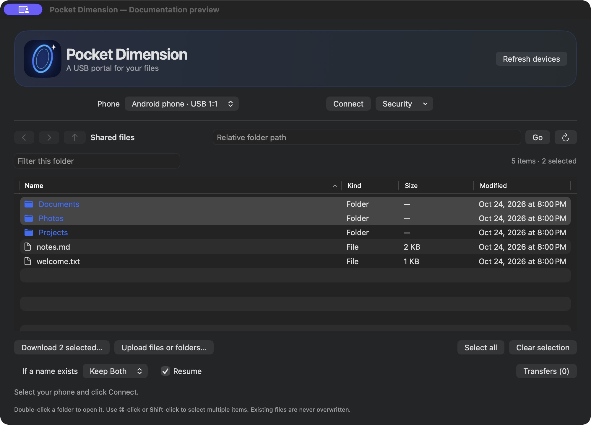
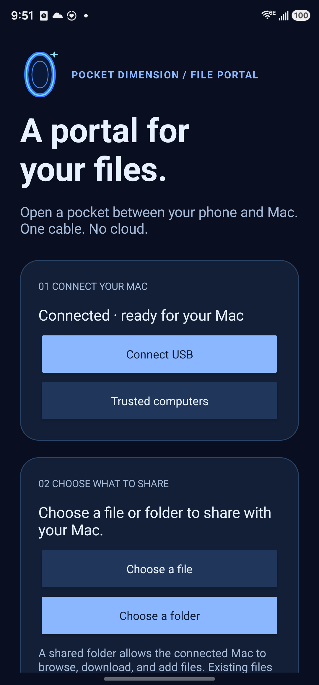

<h1 align="center">android-usb-portal</h1>
<p align="center"><strong>Pocket Dimension · A USB portal for your files.</strong></p>
<p align="center">Move files between Android and macOS over an encrypted USB connection.<br>No cloud account. No network connection. No USB debugging required.</p>

<p align="center">
  <a href="#getting-started">Get started</a> ·
  <a href="#security-and-trust">Security</a> ·
  <a href="#reusable-android-library">Android library</a> ·
  <a href="#build-from-source">Build from source</a>
</p>

<table>
  <tr><th>Pocket Dimension for macOS</th><th>Pocket Dimension for Android</th></tr>
  <tr>
    <td width="74%"></td>
    <td width="26%"></td>
  </tr>
</table>

*Desktop screenshot: the actual GUI with synthetic demo files and an inert USB helper. Android screenshot: the installed app, with no personal files shared.*

## What it does

Pocket Dimension uses **Android Open Accessory (AOA)** to give your Mac access to files you choose on your phone. This repository contains both apps and the reusable Android security library behind their connection.

- **Browse and move files.** Double-click folders, select multiple items, drag files onto the desktop app to upload, and download whole folder trees.
- **Keep control of access.** Share one file, a chosen folder, or optionally primary shared storage. Stop sharing whenever you want.
- **Pair computers explicitly.** Compare certificate fingerprints and approve the computer on your phone. Trust expires after seven days.
- **Verify every file.** SHA-256 verification, stored-file readback for uploads, and overwrite refusal protect transfers.
- **Recover interrupted work.** Cancel, skip, retry, and resume transfers with verified partial data. Queue history stays on your Mac.
- **Use the interface you prefer.** A native SwiftUI desktop app, a matching Android app, and a scriptable CLI.

## Getting started

You'll need:

| Component | Requirement |
| --- | --- |
| Phone | Android 8.0+ with USB accessory support |
| Desktop | macOS 13+; the current packaged build targets Apple Silicon |
| Cable | A USB **data** cable and a compatible port or adapter |
| Apps | Matching Pocket Dimension Android and Mac builds |

The current version is **0.7.0**. Build from source using the instructions below; generated installers and apps live in `dist/`. Local Mac builds are ad-hoc signed and not notarized; Android builds use a debug signing key. See [release and update instructions](docs/releases.md) before distributing a build.

1. Install the Android APK and open **Pocket Dimension** on your phone.
2. Open **Pocket Dimension.app** on your Mac and connect the unlocked phone. Close other Android transfer apps that may claim its USB interface.
3. Click **Connect** on the Mac. Approve Android's accessory prompt if one appears.
4. Choose **Request pairing on phone**. Compare **both complete fingerprints** on the Mac and phone, then approve **Trust for 7 days** on the **phone** only if they match.
5. On Android, choose a file or folder to share. Click **Connect** again on the Mac to load it.
6. Browse, download, or upload within that selection. **Stop sharing** on Android clears access to the selected scope.

macOS may separately ask permission for the desktop helper to access its identity in **Keychain**. This is different from the phone's computer-trust approval. Phone pairing does not automatically share files.

The folder picker works without all-files access. Optional **Share device storage** on Android 11+ requires Android's all-files permission; it exposes primary shared storage, not a root shell or other apps' private data.

## Security and trust

File operations require **authenticated TLS**. There is no automatic fallback to the older plaintext protocol.

| Protection | Behavior |
| --- | --- |
| Identity | Android Keystore identity on the phone; macOS Keychain identity and phone pins on the Mac |
| First pairing | Both full SHA-256 certificate fingerprints are compared on the physical screens; approval happens on the phone |
| Expiry | Seven days from explicit approval; reconnecting does not extend trust |
| Revocation | Forget one or all computers in Android **Trusted computers**, or use the desktop **Security** menu |
| Active access | Expiry and revocation invalidate active sessions; locking or detaching clears the app's sharing selection |
| File scope | Every transfer remains restricted to the scope chosen on Android |

This is a development project with automated and physical-device checks, **not an independently audited security product**. Offline expiry depends on the device clock's integrity. Review the [security design and limits](docs/secure-usb-design.md) before integrating it into a work app.

## Reusable Android library

The **`:usb-android`** AAR owns encryption, identity keys, pairing, trust persistence, seven-day expiry, revocation, and authorized streams. Your app supplies the approval UI, lifecycle integration, and business/data-access policy.

```kotlin
// In a consuming app within this Gradle project:
dependencies {
    implementation(project(":usb-android"))
}
```

```sh
./gradlew :usb-android:assembleRelease
```

Output: `usb-android/build/outputs/aar/usb-android-release.aar`. The module declares no permissions and has no runtime dependencies.

See the [integration guide and API example](usb-android/README.md). The library does not bundle Pocket Dimension's file browser, choose a storage scope, or open USB accessories for your app.

## Command line

The packaged CLI includes its Python runtime and libusb:

```sh
./dist/pocket-dimension devices
./dist/pocket-dimension connect
./dist/pocket-dimension ls
./dist/pocket-dimension pull ~/Downloads/phone-folder --resume
./dist/pocket-dimension push ./Photos --resume --conflict keep-both
```

For terminal-only pairing, `connect` reports both fingerprints. Run the following with the complete phone fingerprint, compare both values with the phone's approval screen, and approve on the phone:

```sh
./dist/pocket-dimension pair --phone-fingerprint FULL_PHONE_SHA256
./dist/pocket-dimension unpair
```

Paths passed to `--remote` are relative to the phone's selected scope. Use `--json` on transfer/listing commands and `--json-progress` on transfers for scripts. The older `pocketpull` command remains an alias. See the [full usage guide](docs/usage.md) for device selection, conflicts, cancellation, resume and troubleshooting.

## Build from source

### Android app and library

Install Android Studio with its bundled JDK, Android SDK platform **36**, and build tools **36.0.0**. Point `ANDROID_HOME` or an untracked `local.properties` at your SDK.

```sh
git clone https://github.com/Ty-Roberts/android-usb-portal.git
cd android-usb-portal
./gradlew :app:assembleDebug :app:lintDebug :usb-android:assembleRelease
```

The APK is `app/build/outputs/apk/debug/app-debug.apk`. Keep the same signing identity when updating an installed app.

### Mac app and CLI

Requires Python **3.10+**, Homebrew libusb, and Apple's command-line tools. Build on the Mac architecture you intend to run.

```sh
brew install libusb
python3 -m venv .venv
source .venv/bin/activate
python -m pip install -e './mac[bundle]'
./scripts/build-mac.sh
./scripts/build-gui.sh
open 'dist/Pocket Dimension.app'
```

Use `./scripts/build-release.sh` for the combined local release workflow. It builds an installer DMG, Android APK, reusable AAR, and a SHA-256 manifest. Source-only CLI use is also available through `pocket-dimension` after the editable installation above.

### Verification

On macOS with Android Studio, SDK 36 and the Python environment installed:

```sh
# Fetch the test-only JSON jar and run Java/Python TLS interoperability checks.
./scripts/test-security.sh
PYTHONPATH=mac .venv/bin/python -m unittest discover -s tests
./scripts/test-gui.sh
./gradlew :app:assembleDebug :app:assembleDebugAndroidTest :app:lintDebug :usb-android:lintRelease
```

The current verification includes **107 automated client/interoperability checks**, native GUI checks, seven Android instrumentation checks, and physical encrypted USB transfers with cancellation, resume, readback, persisted trust and revocation. Hardware checks use generated files in a dedicated test folder. See [hardware validation](docs/hardware-validation.md) for the procedure and limits.

## Project map

| Path | Purpose |
| --- | --- |
| [`app/`](app/) | Android file-sharing app |
| [`usb-android/`](usb-android/) | Reusable secure accessory library |
| [`mac/gui/`](mac/gui/) | Native SwiftUI desktop app |
| [`mac/pocketpull/`](mac/pocketpull/) | Python USB transport, security, protocol and CLI |
| [`tests/`](tests/) | Protocol, security, GUI and physical-device checks |
| [`scripts/`](scripts/) | Build, packaging, test and documentation preview tools |
| [`todo.txt`](todo.txt) | Tasks in standard todo.txt format |

## More information

[Detailed usage](docs/usage.md) · [Wire protocol](docs/protocol.md) · [Security design](docs/secure-usb-design.md) · [Android integration](usb-android/README.md) · [USB measurements](docs/usb-performance.md) · [Release instructions](docs/releases.md) · [Third-party notices](docs/third-party.txt)

Performance measurements in the linked document predate TLS; they describe the earlier batching experiments rather than a throughput claim for v0.7.0. Developer ID signing/notarization, further device compatibility checks, and independent security review remain on the [task list](todo.txt).
